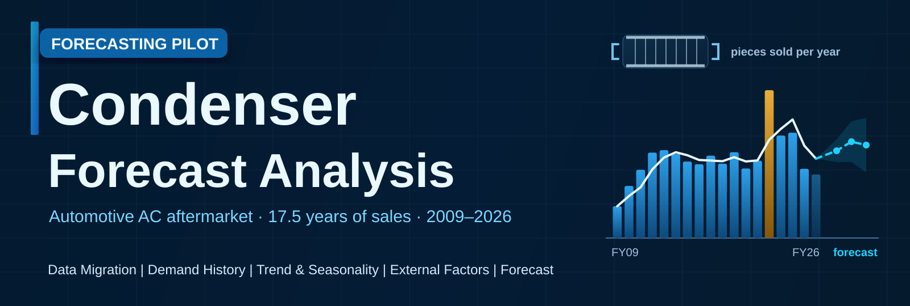

<p align="center">
  
</p>

<p align="center">
  
  
  
  
</p>

<p align="center">
  <a href="#-business-question">Question</a> ·
  <a href="#-key-observations">Observations</a> ·
  <a href="#-methodology">Methodology</a> ·
  <a href="#-data-limitations">Limitations</a> ·
  <a href="#-repository-structure">Structure</a> ·
  <a href="#-status--next-steps">Status</a>
</p>

---

## 📌 Overview

A demand-gap study for an automotive parts distributor (anonymised).

It looks at the historical dispatch pattern of AC condensers for the Maruti Suzuki **Swift** and **Swift Dzire**, centred on the client's own-brand code **PC-86207**, and asks why its volumes collapsed after FY 2012–13.

**Scope:** challan dispatch history Apr 2009 – May 2019 · PC-86207 and related Swift condenser codes · distributor purchasing · vehicle cohorts · indicative competitor pricing.

## ❓ Business Question

> Did demand for the underlying vehicle fitment decline, or did demand shift to another product code, supplier or channel?

A falling SKU is not evidence of a falling market. The study tests the alternatives before drawing a conclusion.

| # | Research objective | Evidence used |
|---|---|---|
| 1 | Measure PC-86207's dispatch trajectory | Challan history by financial year |
| 2 | Check for a product-code transition | Related condenser codes, fitment descriptions |
| 3 | Test for distributor-level shifts | Purchasing concentration by distributor |
| 4 | Size the vehicle base entering the repair age | Swift / Dzire cohorts |
| 5 | Position price against competitors | Available aftermarket price references |

## 🔍 Key Observations

| # | Area | Observation | What it does **not** prove yet |
|---|---|---|---|
| 1 | Demand trajectory | PC-86207 peaked at **~580 units in FY 2012–13** and fell to **~40 units in FY 2014–15** | Whether the fitment lost demand or the volume moved to another code |
| 2 | Code transition | PC-86539 is a candidate successor, but its descriptions cover Swift, Ertiga and SX4 | Its total volume cannot be counted as Swift demand without fitment-level classification |
| 3 | Distributors | Purchasing patterns are examined for changes in concentration and sourcing | A drop in one SKU alone does not show a distributor switched supplier |
| 4 | Vehicle lifecycle | Swift / Dzire cohorts are assessed for entry into the AC repair and replacement age | Vehicle population is a demand indicator, not a confirmed replacement volume |
| 5 | Pricing | Indicative comparison of the client's products against selected competitors | Specs, fitment, quality, margins, taxes and quote dates must be standardised first |

**No single cause is claimed for the PC-86207 decline.** The study separates verified observations from hypotheses and lists the evidence needed to settle each one.

## 🧭 Methodology

1. **Data preparation:** standardise challan product descriptions and resolve inconsistent product references.
2. **SKU analysis:** aggregate dispatch quantity by product code and financial year.
3. **Fitment mapping:** link codes to vehicle model, generation and OEM reference where evidence exists.
4. **Trend analysis:** year-on-year change, peak periods, shift in code contribution.
5. **Distributor analysis:** purchasing concentration and changes in distributor-level demand.
6. **Market research:** competitor products, price references and vehicle applications.
7. **Opportunity assessment:** observations vs hypotheses, and the data needed to validate each opportunity.

**Tools:** Excel · Power Query · XLOOKUP and fuzzy matching · pivot aggregation · cohort analysis · aftermarket desk research.

## ⚠️ Data Limitations

- Challan history covers **Apr 2009 – May 2019** only.
- Post-2019 code-level figures are **provisional** until reconciled against original transactions.
- Multi-application codes must not be read as single-model demand.
- Code succession and supplier substitution remain **hypotheses** until supported by transaction-level evidence.
- Vehicle population is not the addressable replacement market.
- Historical price references may not match current quotations.

## 📂 Repository Structure

```text
Swift_Condenser_Legacy_Analysis/
├── README.md                       this brief
├── CHANGELOG.md                    what changed and when
├── assets/
│   └── banner.svg
├── research/
│   ├── README.md
│   └── 01-first-draft.md           original working draft, kept unchanged for traceability
└── deliverables/
    ├── README.md
    ├── client-ready-report.md      findings, limitations and next steps for the client
    └── commitments.md              scope, quality and data-handling commitments
```

Source challans, distributor-level transactions and price lists are **not** published (see [Data privacy](#-data-privacy)).

## 🚦 Status & Next Steps

**Status:** first draft, under validation.

1. Classify PC-86539 (and other multi-fitment codes) by vehicle application.
2. Reconcile provisional post-2019 figures against the original records.
3. Test supplier substitution at distributor level using full purchase history.
4. Refresh competitor pricing with dated, like-for-like quotations.
5. Convert validated findings into a client presentation.

## 🔒 Data Privacy

Built on real commercial records. The client name, its brand and its part-code prefix are anonymised (`PC-` prefix, as in [Inventory Reconciliation](https://github.com/tanmaymandal0207-cmyk/inventory-reconciliation)). Raw customer records, distributor-level transactions and proprietary pricing are not in this repository. Vehicle models are public information and are kept.

---

**Author:** Tanmay Mandal, Business Analysis · Operations · ERP
© Tanmay Mandal. All rights reserved. Shared for portfolio viewing only.
