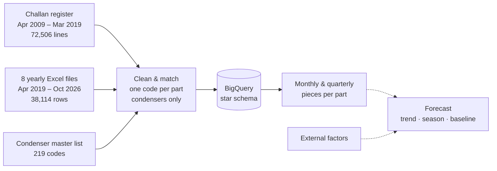
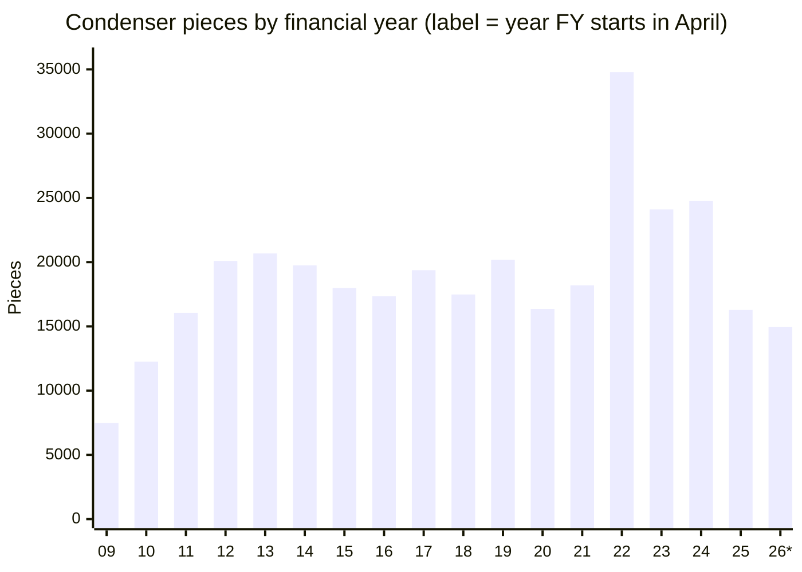

<p align="center">
  
</p>

<p align="center">
  
  
  
  
  
  
</p>

<p align="center">
  <a href="#-business-question">Question</a> ·
  <a href="#-key-observations">Observations</a> ·
  <a href="#️-phase-2-forecasting-pilot-data-foundation">Pilot</a> ·
  <a href="#-methodology">Methodology</a> ·
  <a href="#️-data-limitations">Limitations</a> ·
  <a href="#-repository-structure">Structure</a> ·
  <a href="#-status--next-steps">Status</a>
</p>

---

## 📌 Overview

**Condenser Forecast Analysis** (formerly *Swift Condenser Legacy Analysis*): sales history, data foundation and demand forecasting for the AC condenser range of an automotive parts distributor (anonymised). It began as a demand-gap study of one Swift condenser code.

It looks at the historical dispatch pattern of AC condensers for the Maruti Suzuki **Swift** and **Swift Dzire**, centred on the client's own-brand code **PC-86207**, and asks why its volumes collapsed after FY 2012–13.

**Scope:** challan dispatch history Apr 2009 – May 2019 · PC-86207 and related Swift condenser codes · distributor purchasing · vehicle cohorts · indicative competitor pricing.

The project now runs in two phases:

| Phase | Question | Status |
|---|---|---|
| **1. Demand-gap study** | Why did PC-86207 fall from ~580 to ~40 units a year? | First draft, under validation |
| **2. Forecasting pilot** | Can condenser demand be forecast from past trends and external factors? | Data foundation built (Apr 2009 – Oct 2026); forecasting next |

Phase 2 was requested by the client after the first draft. It starts with condensers only; other parts follow in later stages.

## ❓ Business Question

> Did demand for the underlying vehicle fitment decline, or did demand shift to another product code, supplier or channel?

A falling SKU is not evidence of a falling market. The study tests the alternatives before drawing a conclusion.

| # | Research objective | Evidence used |
|---|---|---|
| 1 | Measure PC-86207's dispatch trajectory | Challan history by financial year |
| 2 | Check for a product-code transition | Related condenser codes, fitment descriptions |
| 3 | Test for distributor-level shifts | Purchasing concentration by distributor |
| 4 | Size the vehicle base entering the repair age | Swift / Dzire cohorts |
| 5 | Position price against competitors | Available aftermarket price references |

## 🔍 Key Observations

| # | Area | Observation | What it does **not** prove yet |
|---|---|---|---|
| 1 | Demand trajectory | PC-86207 peaked at **~580 units in FY 2012–13** and fell to **~40 units in FY 2014–15** | Whether the fitment lost demand or the volume moved to another code |
| 2 | Code transition | PC-86539 is a candidate successor, but its descriptions cover Swift, Ertiga and SX4 | Its total volume cannot be counted as Swift demand without fitment-level classification |
| 3 | Distributors | Purchasing patterns are examined for changes in concentration and sourcing | A drop in one SKU alone does not show a distributor switched supplier |
| 4 | Vehicle lifecycle | Swift / Dzire cohorts are assessed for entry into the AC repair and replacement age | Vehicle population is a demand indicator, not a confirmed replacement volume |
| 5 | Pricing | Indicative comparison of the client's products against selected competitors | Specs, fitment, quality, margins, taxes and quote dates must be standardised first |

**Update from the 2019–2026 data (Phase 2):** PC-86207 did not disappear; it still sells a few dozen units a year (157 in FY 2019–20, 14 in Apr–Oct 2026). The client's master list labels **PC-86539** as *Swift (new)* (14,135 units from Apr 2019 to Oct 2026, including its Q5 grade) and lists a separate **PC-86815** for the *Swift 2017* generation (1,606 units since Jun 2019). This supports a code transition by vehicle generation, but challan descriptions for PC-86539 still name other models, so the fitment split (step 6 below) is still needed.

**No single cause is claimed for the PC-86207 decline.** The study separates verified observations from hypotheses and lists the evidence needed to settle each one.

## 🏗️ Phase 2: Forecasting Pilot, Data Foundation

The client asked for *a system that forecasts future demand from past trends and current external factors* (raw materials, crude oil, sea freight, car sales). Before any forecast, the two record systems had to be brought into one consistent series.



| Result | Figure |
|---|---|
| Condenser history in one series | **Apr 2009 – Oct 2026** (17.5 years) |
| Condenser pieces recorded | **338,096.5** |
| Excel files reconciled to their own *Totals* row | **8 of 8**, exact |
| Old challan codes resolved with the client | **47 of 47** (18 auto-matched, 16 moved to the current code, 2 kept as own parts, 11 excluded) |
| Unmapped codes / double-counted parts after matching | **0 / 0** |
| Open items sent to the client | **6** (A–F), see the [status report](deliverables/migration-status-report.md) |


<sub>FY 2009–10 to 2018–19 from the challan register; FY 2019–20 onwards from the yearly Excel files. *FY 2026–27 is Apr–Oct only. FY 2022–23 is open item A.</sub>

Design and rules: [data model](docs/data-model.md) · SQL: [`sql/`](sql/) · Excel loader: [`pipeline/`](pipeline/).

## 🧭 Methodology

1. **Data preparation:** standardise challan product descriptions and resolve inconsistent product references.
2. **SKU analysis:** aggregate dispatch quantity by product code and financial year.
3. **Fitment mapping:** link codes to vehicle model, generation and OEM reference where evidence exists.
4. **Trend analysis:** year-on-year change, peak periods, shift in code contribution.
5. **Distributor analysis:** purchasing concentration and changes in distributor-level demand.
6. **Market research:** competitor products, price references and vehicle applications.
7. **Opportunity assessment:** observations vs hypotheses, and the data needed to validate each opportunity.

Terms are defined in the [glossary](docs/glossary.md).

**Tools:** Excel · Power Query · XLOOKUP and fuzzy matching · pivot aggregation · cohort analysis · aftermarket desk research · Google BigQuery (SQL views, star schema) · Python (pandas) for loading and reconciling the yearly Excel files.

## ⚠️ Data Limitations

- Challan history covers **Apr 2009 – May 2019**; the yearly Excel files cover **Apr 2019 – Oct 2026** but hold only part code, name and monthly pieces (no customer, distributor or price).
- Apr–May 2019 exist in both sources and disagree (open item C); the Excel files are used from Apr 2019.
- 170 condenser codes in the 2019–2026 files (37,883 pcs, ~22% of that period) are not yet in the client's master list (open item B). Figures for those codes are **provisional**.
- FY 2022–23 (34,783 pcs) is ~1.4× the years either side and is unconfirmed (open item A).
- Multi-application codes must not be read as single-model demand.
- Code succession and supplier substitution remain **hypotheses** until supported by transaction-level evidence.
- Vehicle population is not the addressable replacement market.
- Historical price references may not match current quotations.

## 📂 Repository Structure

```text
Condenser_Forecast_Analysis/
├── README.md                       this brief
├── CHANGELOG.md                    what changed and when
├── .gitattributes / .gitignore     line endings; client data kept out
├── assets/
│   └── banner.svg
├── docs/
│   ├── glossary.md                 challan, fitment, PC- codes and other terms
│   ├── data-requirements.md        data request list for the validation steps
│   └── data-model.md               Phase 2 star schema, grain and source cut-over rules
├── sql/                            BigQuery: load checks, code decisions, condenser series
├── pipeline/                       Python loader for the yearly Excel files
├── research/
│   ├── README.md
│   └── 01-first-draft.md           original working draft, kept unchanged for traceability
└── deliverables/
    ├── README.md
    ├── client-ready-report.md      findings, limitations and next steps for the client
    ├── migration-status-report.md  Phase 2 progress, checks and open items (A–F)
    └── commitments.md              scope, quality and data-handling commitments
```

Source challans, distributor-level transactions and price lists are **not** published (see [Data privacy](#-data-privacy)).

## 🚦 Status & Next Steps

**Phase 1:** first draft, under validation. **Phase 2:** condenser data migrated and checked; waiting on the client's answers to open items A–F.

The data needed for each step below, and the checks it must pass, is listed in [data requirements](docs/data-requirements.md).

| # | Step | Phase | Status |
|---|---|---|---|
| 1 | Load 2019–2026 Excel files and the challan register into one database | 2 | ✅ Done |
| 2 | Resolve old challan codes against the master list | 2 | ✅ Done (47 of 47) |
| 3 | Confirm 170 new 2019–2026 codes, the FY 2022–23 spike and the Apr–May 2019 overlap | 2 | ⏳ With client |
| 4 | Quarterly forecast: trend, seasonality, baseline | 2 | Next |
| 5 | Add external factors: raw materials, crude oil, sea freight, car sales | 2 | Later |
| 6 | Classify PC-86539 (and other multi-fitment codes) by vehicle application | 1 | Open |
| 7 | Test supplier substitution at distributor level using full purchase history | 1 | Open |
| 8 | Refresh competitor pricing with dated, like-for-like quotations | 1 | Open |
| 9 | Non-condenser parts | 2 | Later stages |

## 🔗 Related Projects

- [Inventory Reconciliation](https://github.com/tanmaymandal0207-cmyk/inventory-reconciliation): challan vs stock reconciliation with an audit register, using the same anonymised `PC-` part codes
- [Commercial Intelligence Dashboard](https://github.com/tanmaymandal0207-cmyk/Commercial-Intelligence-Dashboard): Power BI revenue, pricing and lifecycle analysis across an automotive product portfolio
- [SQL Business Problems](https://github.com/tanmaymandal0207-cmyk/sql-business-problems): problem → SQL → validation case studies in BigQuery

## 🔒 Data Privacy

Built on real commercial records. The client name, its brand and its part-code prefix are anonymised (`PC-` prefix, as in [Inventory Reconciliation](https://github.com/tanmaymandal0207-cmyk/inventory-reconciliation)). Raw customer records, distributor-level transactions, proprietary pricing, the client's Excel files and the database extracts are not in this repository. The SQL uses placeholder project and dataset names, and the code pattern uses the anonymised prefix. Vehicle models are public information and are kept.

---

**Author:** Tanmay Mandal, Business Analysis · Operations · ERP · [LinkedIn](https://www.linkedin.com/in/tanmay-mandal-286623247)
© Tanmay Mandal. All rights reserved. Shared for portfolio viewing only.
