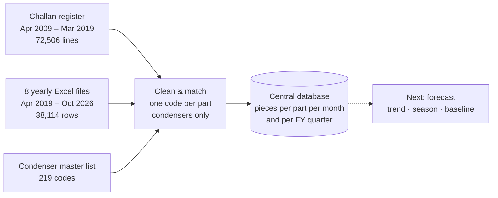
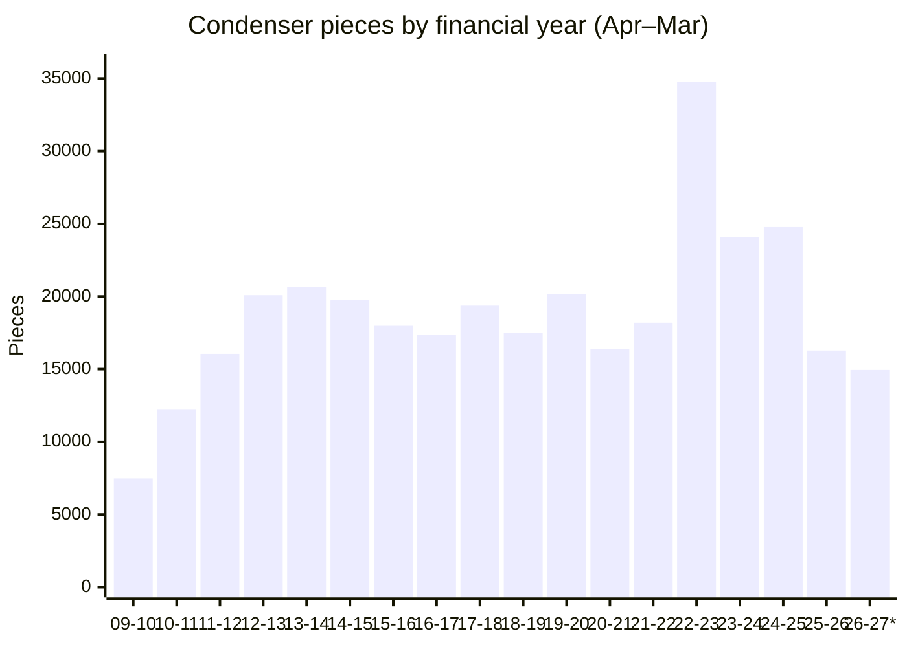
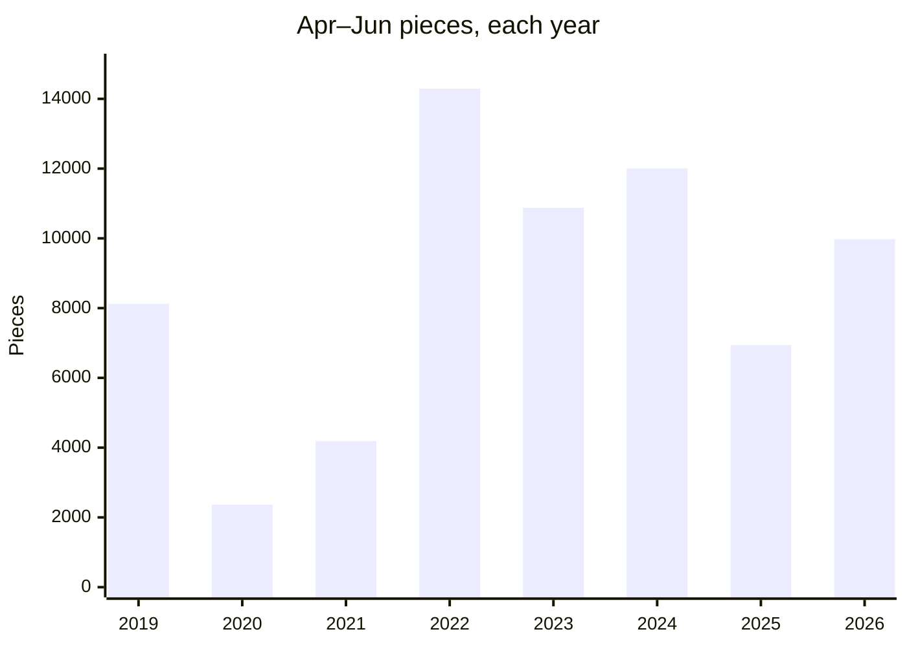

# Condenser Data Migration — Status Report

**Client:** automotive parts distributor (anonymised) · **Date:** 18 Nov 2026 · **Data:** Apr 2009 – Oct 2026 · **Phase:** 2, forecasting pilot

Published version of the status report sent to the client as a PDF. Client and brand names are removed; codes use the `PC-` prefix.

---

## 1. Summary

The client's condenser sales history from April 2009 to October 2026 is now in one database, in the same format for every year. Before the forecast is built, six points where the records disagree or are unclear need the client's confirmation. Each answer decides how a block of sales is counted.

| 17.5 years | 338,097 | 47 of 47 | 6 |
|:---:|:---:|:---:|:---:|
| of condenser sales in one place | condenser pieces recorded | old challan codes resolved | open items (A–F) |

Nothing in the original records has been changed. All cleaning happens in separate tables, so every figure traces back to its source line.

## 2. How the data moves

## 3. Progress

| Step | Status | Detail |
|---|---|---|
| 1. Collect source data | ✅ Done | Challan register, 8 yearly Excel files, condenser master list |
| 2. Load into the database | ✅ Done | Totals checked against each file's own *Totals* row; originals unchanged |
| 3a. Match old challan codes (2009–2019) | ✅ Done | All 47 resolved with the client's decisions |
| 3b. Match new codes (2019–2026) | ⏳ With client | 170 codes not in the master list (item B) |
| 4. One sales series, monthly and quarterly | ✅ Provisional | Final once items A–F are closed |
| 5. Forecast: trend, season, baseline | Next | Starts after items A–C |
| 6. External factors | Later | Raw materials, crude oil, sea freight, car sales |
| 7. Non-condenser parts | Later | Later stages, as agreed |

## 4. Checks

| Check | Result |
|---|---|
| Each Excel file: loaded total = file's *Totals* row | All 8 match exactly |
| Each file: row totals = month totals | Match; no duplicate items |
| Every condenser row has a part code and FY quarter | 0 missing |
| Challan codes not matched to the master list | 0 (was 47 codes, 18,544 pcs) |
| Same part counted twice after matching | 0 |
| Challan pieces before vs after decisions | 171,210.5 − 2,742 excluded = 168,468.5 |

## 5. Condenser pieces by financial year

To FY 2018–19: challan register. From FY 2019–20: yearly Excel files. *Apr–Oct 2026 only.

Sales stayed between about 16,000 and 21,000 pieces a year from FY 2012–13 to FY 2021–22. FY 2022–23 stands out at 34,783. April 2020 has no sales because of the national lockdown; this is genuine and kept as recorded.

## 6. Open items

| | Item | What is needed | Priority |
|---|---|---|---|
| A | FY 2022–23 is ~1.4× the years either side | Real demand or a recording issue? | 🔴 High |
| B | 170 condenser codes not in the master list | Confirm each code (sheet sent) | 🔴 High |
| C | Apr–May 2019 in both records, different figures | Which source is correct? | 🟠 Medium |
| D | PC-86808 has three different descriptions | One part or several? Which OEM number? | 🟠 Medium |
| E | PC-86910, Jul 2018: 47.5 pieces | Correct whole number | ⚪ Low |
| F | 60 negative entries (−182 pcs) | Confirm these are returns | ⚪ Low |

### A. FY 2022–23 spike

34,783 pieces, against 18,193 the year before and 24,100 the year after. Most of the jump is in **Apr–Jun 2022: 14,293 pieces**, against 4,189 a year earlier. April 2022 alone had 6,046, the highest month since April 2019.

| Code | FY 2021–22 | FY 2022–23 | FY 2023–24 |
|---|---:|---:|---:|
| PC-86539 (Swift new) | 1,242 | **2,848** | 1,861 |
| PC-86541-Q5 | 647 | **1,302** | 458 |
| PC-86539-Q5 | 81 | **638** | 30 |
| PC-86535 | 162 | **819** | 559 |
| PC-86634 | 528 | **960** | 664 |

**Question:** a real rise in orders (bulk or stock-up order, new customer, shortage from other suppliers), or sales entered twice? If it was a one-off, it is marked so the forecast does not expect it to repeat.

### B. 170 new codes

These account for **37,883 pieces, about 22% of condenser sales since April 2019**. Some are clearly new models (PC-86903Q5 Celerio Q5, 3,154 pcs; PC-86982Q5 Honda WR-V; PC-86868Q5 Grand i10 Nios); others may be the same part written differently.

| Pieces sold 2019–26 | Codes | Pieces |
|---|---:|---:|
| 500+ | 27 | 23,335 |
| 200–499 | 27 | 8,124 |
| 50–199 | 51 | 5,209 |
| under 50 | 65 | 1,215 |

The 54 codes with 200+ pieces cover 83% of the volume. The client marks each code as *New part*, *Same as another code*, *Not a condenser* or *Ignore*.

### C. Apr–May 2019 overlap

| Month | Challan register | 2019 Excel file |
|---|---:|---:|
| April 2019 | 2,600 | 2,664 |
| May 2019 | 1,390 | 2,984 |

The database uses the Excel file from April 2019, so no month is counted twice. The May gap suggests the challan register is incomplete for that month.

### D. PC-86808 descriptions

| Source | Description |
|---|---|
| Master list | Volvo, OEM part no. 14645543 |
| Challan register | Volvo, OEM part no. 14509377 |
| 2019–2026 Excel files | Kobelco 450 earthmover |

### E and F

- **E.** PC-86910 challans for July 2018 add up to 47.5 pieces, the only fractional quantity in the condenser records.
- **F.** 60 condenser rows in the 2019–2026 files are negative (−182 pcs). They are treated as returns and netted in the month recorded.

## 7. Decisions already applied

| Outcome | Codes | Example |
|---|---:|---|
| Matched to the same code in the master list | 18 | PC-86808Q5 → PC-86808-Q5 |
| Moved to the suggested current code | 16 | PC-86581AQ5 → PC-86581-Q5 (Brio Q5) |
| Kept as their own part | 2 | PC-86036 Indica 134A (5,127 pcs); PC-86555L Cruze diesel (135 pcs) |
| Excluded, as advised | 11 | 2,742 pcs left out |

## 8. Next steps

| | Step | Who |
|---|---|---|
| 1 | Answer items A, C, D, E, F | Client |
| 2 | Fill in the new-codes sheet (item B), highest volume first | Client |
| 3 | Apply answers and re-run all checks | Analyst |
| 4 | Quarterly condenser forecast: trend, seasonality, baseline | Analyst |
| 5 | External factors: raw materials, crude oil, sea freight, car sales | Analyst, next stage |

Items A–C have the biggest effect on the forecast; those three answers are enough to begin.

---

Prepared by Tanmay Mandal. Customer, distributor and price detail are withheld.
