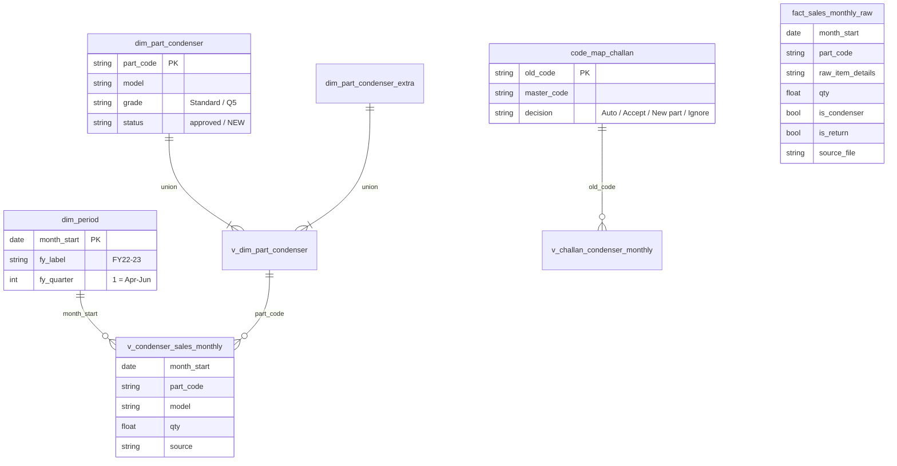

# Data Model (Phase 2)

[← Back to README](../README.md)

How the forecasting pilot stores condenser sales. Built in Google BigQuery; the same design works in any SQL database.

## Design goals

The client asked for a database that needs only **dates, part codes, part names and quantities**, summarised **quarterly**. The pilot keeps condenser data accurate first; other parts are cleaned in later stages.

1. **Raw data is never edited.** Source tables are loaded as received; all cleaning happens in new tables and views.
2. **Monthly grain, quarterly output.** Facts are stored per part per month, so quarters, years and any future period can be rebuilt without reloading.
3. **One code per part.** Every spelling of a code maps to one master code through a lookup table, so a part is never split or counted twice.
4. **Every figure traces back.** Each row keeps its source (challan register or the Excel file name).

## Schema

## Tables and views

| Object | Type | Grain | Purpose |
|---|---|---|---|
| `challan_master` | table (raw) | challan line | Original register, Apr 2009 – May 2019. Not modified. |
| `fact_sales_monthly_raw` | table | file row × month | The 8 yearly Excel files unpivoted to one row per item per month (38,114 rows, all parts). |
| `part_alias` | table | raw description | Every raw description, the code read from it and how it matched the master. |
| `dim_part_condenser` | table | part code | Condenser codes seen in 2019–2026, marked approved or NEW. |
| `dim_part_condenser_extra` | table | part code | Master codes not sold since 2019, plus old codes the client kept as own parts. |
| `code_map_challan` | table | old challan code | The client's decision for each old code. |
| `dim_period` | table | month | Month → financial year and FY quarter, Apr 2009 – Mar 2027. |
| `v_challan_condenser_monthly` | view | part × month | Condenser lines from the challan register (Active, Item, PCS) up to Mar 2019. |
| `v_dim_part_condenser` | view | part code | Full part list (union of the two part tables). |
| `v_condenser_sales_monthly` | view | part × month | One series: challan register to Mar 2019, Excel files from Apr 2019. |
| `v_condenser_sales_quarterly` | view | part × FY quarter | Input to the forecast. |

## Rules

| Rule | Detail |
|---|---|
| Financial year | April to March. `FY22-23` = Apr 2022 – Mar 2023. Q1 = Apr–Jun, Q4 = Jan–Mar. |
| Source cut-over | Challan register up to **Mar 2019**; Excel files from **Apr 2019**. Apr–May 2019 exist in both and disagree, so only one source is used per month (open item C). |
| Challan filter | `Status = 'Active'`, `Line_Type = 'Item'`, `UoM = 'PCS'`. Use `Date`, not the inconsistent `Year` labels. |
| Condenser test | Part code matches the condenser series pattern (`PC-86xxx`, `PCP-C86xxx` and spacing variants). |
| Code matching | Exact raw spelling first (the client decided per spelling), then normalised code (upper case, letters and digits only), then the raw code. |
| Excluded codes | Codes the client marked *Ignore* are dropped from the series (2,742 pcs). |
| Returns | Negative Excel cells are kept, flagged `is_return`, and netted in the month recorded (open item F). |
| Combined codes | Descriptions holding two codes (e.g. `PC-86457 / PC-86843`) map to the master entry that holds both. |

## Checks run after each load

| Check | Expected |
|---|---|
| Loaded total per Excel file = file's own *Totals* row | Exact match, all 8 files |
| Row totals = sum of monthly cells | Exact match |
| Condenser rows without a part code or FY quarter | 0 |
| Challan condenser codes not in the part list | 0 |
| Part codes appearing twice in the part list | 0 |
| Challan pieces before − excluded = pieces in the series | 171,210.5 − 2,742 = 168,468.5 |

The SQL for each check is in [`sql/01_setup_and_checks.sql`](../sql/01_setup_and_checks.sql) and [`sql/04_validation.sql`](../sql/04_validation.sql).
