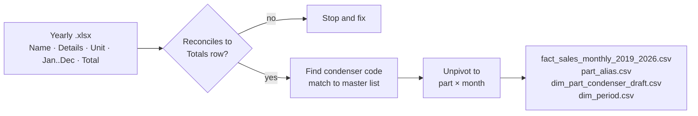

# Pipeline

[`excel_to_long.py`](excel_to_long.py) turns the client's yearly sales workbooks (one row per item, a column per month) into the monthly long table and lookup files loaded into BigQuery.



## Run

```bash
pip install pandas openpyxl
python excel_to_long.py --input data/yearly --master data/master.tsv --out out/
```

The brand prefix is anonymised to `PC-` here. Set `CODE_PATTERN` to the real pattern when running on client data.

## What it checks

| Check | Result on the 8 client files |
|---|---|
| Sum of item totals = file's *Totals* row | All 8 match exactly |
| Each month's column sum = *Totals* row for that month | All match |
| Row total = sum of its 12 months | 0 mismatches |
| Duplicate items (same name and details) in a file | 0 |
| Negative cells (returns) | Kept and flagged `is_return` |

Output on the client files: 38,114 rows, of which 10,957 condenser rows (169,628 pcs); 353 condenser codes, 183 in the master list and 170 new.

## How codes are matched

| Status | Meaning |
|---|---|
| `master_exact` | The whole code, normalised, is in the master list |
| `master_via_combined_code` | A description with two codes (`PC-86457 / PC-86843`) where one part matches |
| `not_in_master` | A condenser code the master list does not have; sent to the client to confirm |
| `not_condenser_series` | Not a condenser; kept in the fact table for later stages |
